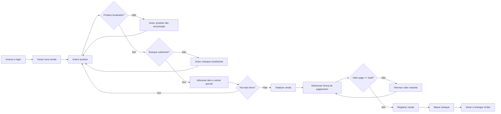
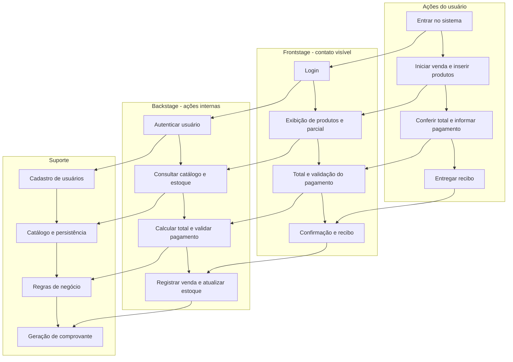
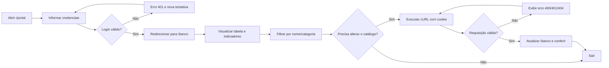
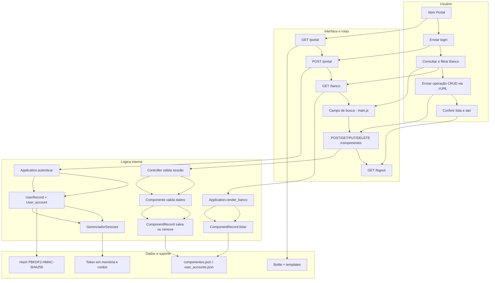

# Diagramas editáveis

Os diagramas Mermaid abaixo representam os quatro níveis. Para visualizar, abra este arquivo no GitHub ou copie o bloco para um editor compatível com Mermaid.

## Nível 1 — Jornada Desktop

## Nível 2 — Blueprint Desktop

## Nível 3 — Jornada TechStock

## Nível 4 — Blueprint TechStock

